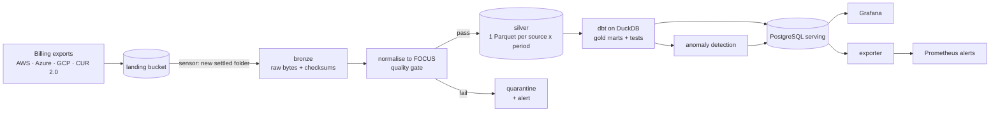
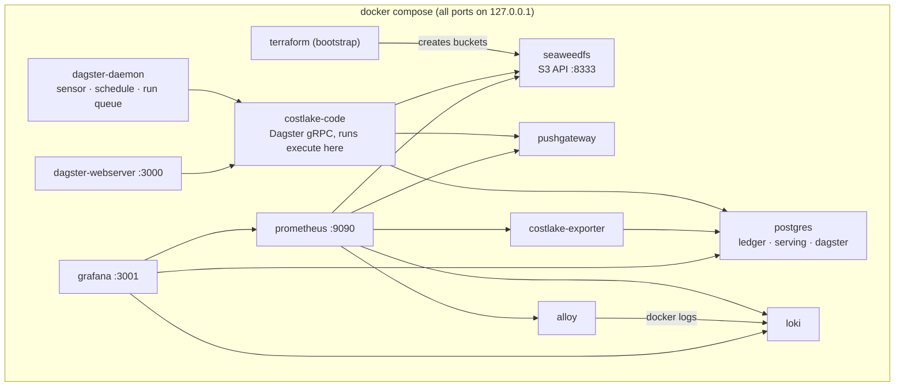

# costlake

FinOps lakehouse for cloud billing data. costlake ingests FOCUS 1.0 billing exports from AWS, Azure and Google Cloud (plus legacy AWS CUR 2.0) into a bronze/silver/gold lake on S3. Every delivery is quality-gated, restated months are handled without double counting, and cost is allocated to teams. Spend anomalies are detected and exposed through PostgreSQL, Prometheus alerts and Grafana dashboards.

Python · Polars · DuckDB · dbt · Dagster · PostgreSQL · S3 (SeaweedFS locally) · Terraform · Docker Compose · Prometheus · Loki · Grafana · GitHub Actions

---

## The problem

Cloud bills are now available in a common schema, [FOCUS](https://focus.finops.org), exported natively by AWS Data Exports, Azure Cost Management and Google Cloud. Turning those exports into reliable numbers is still an engineering problem:

* **Bills are restated.** The current month is re-exported several times a day until it closes (late usage, credits, refunds). A pipeline that appends double counts; one that processes files out of order goes back in time.
* **Exports are not always clean.** Columns go missing, values fail to parse, and new charge types appear. A silently half-loaded month understates spend, which is worse than no data.
* **Cost must be owned.** Showback needs cost allocated by tag, and the untagged share must be measured.
* **Spikes are found late.** Without detection, a runaway cluster or a full-scan query shows up on the invoice a month later.

## What costlake does

| Capability | How |
|---|---|
| Event-driven ingestion | A Dagster sensor detects new export folders in the landing bucket, waits until they are fully written, and lands them byte-for-byte in bronze, with checksums in a ledger. Ingestion is idempotent. |
| Multi-format normalisation | Adapters map FOCUS exports (Parquet/CSV/CSV.gz) and AWS CUR 2.0 to one FOCUS contract. CUR commitments are amortised, and the billed total is preserved exactly. |
| Quality gate | 12 rules (8 blocking, 4 warnings) run on every delivery. A failing delivery is quarantined with its reason, the others continue, and it can be requeued after a fix. |
| Restatement handling | Silver holds one Parquet object per (source, billing period). The newest export replaces it, and an older export processed late never overwrites newer data. |
| Gold layer | dbt on DuckDB, reading silver directly from S3: daily cost fact, showback per owner, tag coverage, commitment savings and month-to-date forecast. 17 dbt data tests, including a silver-to-gold reconciliation test. |
| Anomaly detection | Robust z-score (median/MAD) per provider and service, with a weekday profile and financial floors, so weekend dips don't page anyone. |
| Serving | Gold tables are swapped atomically into PostgreSQL for Grafana and the metrics exporter. |
| Observability | Business and lake-state metrics, batch-step telemetry, 11 alert rules (unit-tested with `promtool`), JSON logs centralised in Loki and two provisioned dashboards. |
| Infrastructure as code | Terraform modules for the buckets (the same module runs on SeaweedFS locally and on AWS), the AWS FOCUS export and a least-privilege IAM role, tested offline with `terraform test`. |

## Architecture





The component choices, guarantees, failure handling and security model are in [docs/architecture.md](docs/architecture.md). The layers, the FOCUS contract, the CUR 2.0 mapping, the quality rules, the gold models and the anomaly method are in [docs/data-model.md](docs/data-model.md).

### Why these technologies

* **Polars** for normalisation: strict, columnar casting with failure accounting, and no JVM.
* **DuckDB + dbt** for gold: reads Parquet on S3 directly, with versioned and tested SQL. At this data volume (gigabytes per month) a warehouse server or a Spark cluster would add operations without changing results.
* **Dagster** for orchestration: the asset graph *is* the lineage (bronze → silver → each dbt model → anomalies → serving). dbt tests show up as asset checks, the sensor gives event-driven runs, and retry policies cover transient failures.
* **PostgreSQL**: transactional ledger (partition ownership switches atomically), Dagster storage, and a serving layer Grafana can query.
* **Prometheus + Pushgateway**: pull for the lake's state, push for short-lived batch steps.
* **SeaweedFS** as the local S3: maintained and Apache-2.0, it supports per-bucket identities, and Terraform's `aws` provider manages it unchanged. MinIO no longer publishes community images.

## Getting started

Requirements: Docker with Compose v2 and about 6 GB of RAM for the containers. For development without Docker: Python 3.11 to 3.13 and Terraform ≥ 1.7.

```bash
git clone https://github.com/zabubu/costlake && cd costlake
make up          # random secrets in .env, build, Terraform creates the buckets, wait for health checks
make demo-data   # 120 days of synthetic exports for 4 sources, with 3 injected incidents
```

Within about two minutes, the sensor picks up the exports and runs the pipeline. Then open:

| Interface | URL | What to look at |
|---|---|---|
| Dagster | http://127.0.0.1:3000 | Asset lineage, the run, asset checks (quality gate and dbt tests) |
| Grafana | http://127.0.0.1:3001 (`admin` / `GRAFANA_ADMIN_PASSWORD` in `.env`) | *FinOps overview* and *Platform health* dashboards |
| Prometheus | http://127.0.0.1:9090/alerts | `CostlakeCostAnomaly` firing for the injected AKS drop |

```bash
make e2e         # end-to-end verification of the running platform (see below)
make down        # stop, keep data · make destroy: terraform destroy + remove volumes
```

### Without Docker

The pipeline also runs on the local filesystem with SQLite, which is useful to read the code with a debugger:

```bash
make install
export COSTLAKE_ENV=ci              # local storage, no settle delay
.venv/bin/costlake generate         # synthetic exports into ./data/object-store
.venv/bin/costlake pipeline run     # ingest → normalise → dbt → anomalies
.venv/bin/costlake status
```

### Configuration

| Where | What |
|---|---|
| `.env` (generated, git-ignored) | Passwords and S3 keys of the local platform; see `.env.example` |
| `COSTLAKE_*` environment variables | Endpoints, buckets, database URLs and log format (`src/costlake/config.py`, class `Settings`) |
| `config/environments/{local,ci,prod}.yaml` | Sources (id, format, prefix), settle delay, quality thresholds, anomaly parameters, validated at start-up (`costlake validate-config`) |

Adding a source is a YAML entry: `id`, `format` (`focus` or `aws_cur2`) and the landing `prefix`.

## Usage examples

Find yesterday's top cost drivers per owner (PostgreSQL, `serving` schema):

```sql
select owner, service_name, round(sum(effective_cost)::numeric, 2) as cost
from serving.fct_daily_cost
where charge_date = current_date - 1
group by owner, service_name
order by cost desc
limit 10;
```

Investigate a quarantined delivery and replay it after a fix:

```bash
docker compose exec costlake-code costlake deliveries list
#   4f0c…  quarantined  azure-focus  azure/focus/2026-11/…/
#       error: type_casts: values that could not be parsed: BilledCost=3
docker compose exec costlake-code costlake deliveries requeue 4f0c…
```

Follow one pipeline run across all its steps in Grafana → Explore → Loki:

```logql
{service="costlake-code"} | json | run_id="ad443bfbfa28"
```

## Tests

| Suite | Command | What it proves |
|---|---|---|
| Unit (59) | `make test` | Readers and type-cast accounting, both adapters (CUR 2.0 → FOCUS round trip preserves billed and effective totals), every quality rule, the detector (spikes, drops, seasonality, masking, floors), discovery and idempotent landing, ledger state transitions, S3 store against moto, config validation, metrics never breaking the pipeline |
| Integration (7) | `make test-integration` | Full pipeline with real dbt: exactly the 3 injected incidents detected (no false positive), idempotent re-run, restated month replaces the previous delivery, a late older export does not overwrite newer data, corrupt or incomplete deliveries are quarantined while the others publish. On PostgreSQL: ledger, atomic republication to `serving`, exporter output. Dagster definitions and lineage load. |
| dbt (17 data tests) | run by the pipeline | Grain uniqueness, accepted values, ratio bounds, gold/silver reconciliation |
| Terraform (10) | `make tf-check` | `fmt`, `validate`, `terraform test` with mocked providers: hardened buckets, KMS switch, S3-compatible mode, least-privilege IAM policy (asserted on the rendered JSON), input validation |
| Alert rules | `make promtool` | Prometheus config is valid and the rules fire, or don't, on synthetic series |
| End-to-end | `make e2e` | On the running platform: health of every service and scrape target; exports written with the *exporter* identity; sensor-triggered run succeeds; 7 serving tables populated; the 3 incidents detected; Grafana role is read-only; metrics and step telemetry scraped; anomaly alert firing and no platform alert; logs queryable in Loki; datasources and dashboards provisioned; a re-export restates without double counting; no run without new data |

Results of the verification run before publication (macOS, Docker on Colima, 4 vCPU / 8 GB):

| Check | Result |
|---|---|
| `make lint` | ruff format and lint clean, `mypy --strict`: no issues in 38 source files |
| `make test` + `make test-integration` | 59 unit + 7 integration tests passed, 91 % line coverage combined |
| dbt | 24 nodes (7 models, 17 data tests), all passing |
| `make tf-check` + tflint | 5 Terraform roots valid, 10 `terraform test` runs passed, tflint clean |
| `make promtool` | config valid, 11 rules, rule unit tests passed |
| Security | pip-audit: no known vulnerability; trivy config (modules, AWS env, Dockerfile, Compose): no HIGH/CRITICAL; trivy image: no fixable HIGH/CRITICAL; gitleaks: no secret |
| `make destroy && make up && make e2e` | passed from an empty Docker host: first sensor-triggered run in about 2 minutes, 3/3 injected incidents detected with no false positive, restatement run with identical totals (207,879.64) |

## CI/CD

`.github/workflows/ci.yml` runs on every push and pull request. Every step is a Make target, so failures reproduce locally.

| Job | Content |
|---|---|
| lint | `ruff format --check`, `ruff check` (annotated in the PR), `mypy --strict` |
| test | Python 3.11 / 3.12 / 3.13 with a PostgreSQL service: unit, integration, coverage. A Markdown summary of the failed tests goes into the job summary, and JUnit, coverage and dbt logs are uploaded as artifacts |
| terraform | fmt, validate, `terraform test`, tflint (AWS ruleset) |
| security | pip-audit on the locked dependencies, gitleaks on the git history, trivy on Dockerfile, Compose and Terraform |
| docker | hadolint, cached build, smoke test (CLI and Dagster definitions load in the image), trivy image scan (fixable HIGH/CRITICAL) |
| e2e | `make up` + `make e2e` on the runner. On failure, every container's logs and status are uploaded and the status is written to the job summary |

`release.yml` publishes the image to GHCR with build provenance, only when a `v*.*.*` tag is pushed. Dependabot tracks actions, base images and Terraform providers. Actions are pinned to commit SHAs.

## Deployment

The local platform is fully reproducible with `make up` / `make destroy`. The AWS environment (`infrastructure/terraform/envs/aws`) creates the hardened buckets, the FOCUS Data Export and the pipeline IAM role. It is validated and tested offline but **never applied by CI**. The procedure, cost (a few cents per month of S3) and destruction steps are in [docs/deployment.md](docs/deployment.md). The day-to-day operations and the alert runbook are in [docs/operations.md](docs/operations.md).

## Project layout

```text
src/costlake/
  config.py            settings (env) + pipeline config (YAML), validated
  storage/             S3 and filesystem object stores, retries
  ingestion/           delivery discovery and bronze landing
  normalization/       FOCUS contract, readers, adapters (focus, aws_cur2), silver writer
  quality/             quality rules
  ledger/              operational metadata (SQLAlchemy Core)
  transform/           dbt runner, DuckDB connection settings
  anomaly/             detector
  serving/             PostgreSQL publisher
  observability/       Pushgateway telemetry, Prometheus exporter
  orchestration/       Dagster assets, checks, sensor, schedule
  generator/           synthetic FOCUS / CUR 2.0 data
  pipeline.py, cli.py  orchestrator-independent steps, command line
dbt/                   staging + marts + tests
config/environments/   local, ci, prod
infrastructure/
  docker/              Dagster instance, PostgreSQL roles, SeaweedFS identities
  terraform/           modules (lake-buckets, aws-focus-export, pipeline-access) + envs (local, aws)
monitoring/            Prometheus (+ rule tests), Loki, Alloy, Grafana provisioning and dashboards
tests/                 unit, integration
scripts/               init-env, e2e, JUnit summary
```

## Known limitations

* **Single node.** DuckDB is a single writer (runs are serialised) and a delivery is normalised in memory. This is comfortable for one organisation's billing (gigabytes per month); partitioned processing of very large exports is on the roadmap.
* **Synthetic demo data.** Real billing exports cannot be published. The generator reproduces FOCUS semantics and the CUR 2.0 layout, and the adapters follow the providers' documented schemas, but they have not been run against every provider variant (Azure's EA vs MCA columns, FOCUS 1.1+ columns).
* **AWS environment not applied.** It is validated and tested with mocked providers only. In particular, the `aws` dbt target (credential chain) and the Data Exports query were checked for validity, not executed against an account.
* **Unused commitments.** The CUR 2.0 adapter does not emit FOCUS `Unused` commitment rows.
* **Alert routing.** Alerts fire in Prometheus and show in Grafana; there is no Alertmanager routing to chat or a pager.
* **Image size.** The image is about 430 MB compressed (1.7 GB on disk), mostly Dagster, dbt, Arrow and Polars.
* **No authentication on Dagster.** The local platform binds to 127.0.0.1 for this reason.

## Roadmap

1. Alertmanager with routing to Slack or e-mail per severity and owner.
2. Unused-commitment rows and FOCUS 1.2 columns (`ServiceSubcategory`, `CapacityReservation*`).
3. Budgets per owner (YAML) with burn-rate alerts.
4. Helm chart and a Kubernetes deployment with the Dagster K8s run launcher, once runs need isolation.
5. Silver writes partitioned by day inside the period, for very large exports.
6. Iceberg tables for silver (time travel instead of bucket versioning).

## License

[Apache License 2.0](LICENSE).
