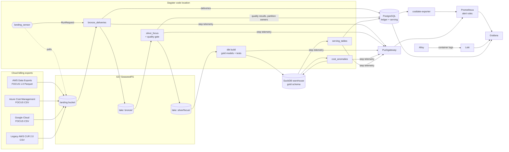

# Architecture

## Components

| Component | Role | Why this choice |
|---|---|---|
| Object storage (S3 API) | Landing, bronze and silver layers | Exports are delivered to S3 by providers; the S3 API is the integration point. Locally SeaweedFS (Apache-2.0, actively maintained) stands in for S3. |
| PostgreSQL | Ledger (deliveries, partitions, quality results, step runs), Dagster instance, serving schema | Transactions make the "which delivery owns which partition" switch atomic. A server database is also what Grafana and the exporter need. |
| Polars | Bronze → silver normalisation | Columnar, multi-threaded, strict casting with explicit failure accounting. No JVM; a month of a mid-size organisation's billing fits in memory on one node. |
| DuckDB + dbt | Silver → gold | DuckDB reads Parquet directly from S3; dbt brings versioned SQL models, lineage and data tests. Avoids running a warehouse server for a few GB. |
| Dagster | Orchestration | Asset-based: lineage of bronze → silver → dbt models → anomalies → serving is the dependency graph itself; dbt tests become asset checks; sensors give event-driven runs. |
| Prometheus + Pushgateway + exporter | Metrics and alerts | Pull model for the lake state (exporter), push for short-lived batch steps (Pushgateway). Alert rules are unit-tested with `promtool`. |
| Loki + Alloy | Centralised logs | JSON logs with `run_id` and `step`: one query follows a pipeline run across steps. Alloy replaces the deprecated Promtail. |
| Grafana | Dashboards | One tool over the three data sources (PostgreSQL serving tables, Prometheus, Loki). |
| Terraform | Buckets locally and on AWS, FOCUS export, IAM | Same module (`lake-buckets`) on SeaweedFS and AWS; `terraform test` with mocked providers runs in CI without credentials. |

What is deliberately **not** used:

* **Spark**: billing data of one organisation is gigabytes, not terabytes, per month. Spark would add a cluster to operate without changing the result. The silver writer works per (source, period) partition, which is the unit to distribute if volumes ever require it.
* **Kafka**: billing exports are batch files refreshed a few times a day. An event bus would only relay S3 object notifications.
* **Kubernetes/Helm**: the platform is a dozen containers on one host. Compose keeps the project runnable by anyone in one command; the image is orchestrator-agnostic (see the roadmap).

## Data flow and guarantees

1. **Landing → bronze** (`bronze_deliveries`). Objects are grouped by folder into *deliveries*. A delivery id is a hash of the folder and the ETags of its files, so re-scanning an unchanged bucket is a no-op and a rewritten export is a new delivery. A folder is ignored until its newest object is older than `ingestion.settle_seconds`, so an export still being uploaded is never read half-way. Raw bytes are copied unchanged to `bronze/source=…/delivery=…/` with their SHA-256 recorded in the ledger.
2. **Bronze → silver** (`silver_focus`). Files are read (CSV as text, Parquet typed), mapped to the FOCUS contract by the source's adapter, then gated by twelve quality rules (see [data-model.md](data-model.md#quality-gate)). A failing `error` rule quarantines the whole delivery: a partial month would understate cost. Valid data is written as one Parquet object per `(source, billing period)`, **replacing** the previous one, then the ledger points the partition at the new delivery in one transaction.
3. **Silver → gold** (dbt). Staging view over all silver objects, six marts, 17 data tests including a reconciliation test (gold totals equal silver totals).
4. **Anomalies** (`cost_anomalies`). Robust z-score per provider/service, weekday-adjusted ([details](data-model.md#anomaly-detection)).
5. **Serving** (`serving_tables`). Each gold table is copied to PostgreSQL through a staging table and swapped in one transaction: readers see the old or the new version, never an empty table.

### Restatement and ordering

Providers rewrite the current month many times (late usage, credits, refunds). Appending would double count. Silver therefore *replaces* a partition with the newest delivery covering it. "Newest" is the export time (object `LastModified`), not processing order: if an older export is processed after a newer one (retry, backlog), the newer partition is kept and the late delivery is marked `superseded`. Both paths are covered by integration tests and by the end-to-end test.

### Failure handling

| Failure | Behaviour |
|---|---|
| Transient S3 error (throttling, 5xx, connection reset) | Retried with exponential backoff in the client (`tenacity` on top of botocore retries), then the Dagster step is retried (`RetryPolicy`, 3 attempts, exponential backoff). |
| Unreadable file, missing required columns, unparseable values, quality `error` | Delivery quarantined with the reason in the ledger; other deliveries continue; alert `CostlakeDeliveryQuarantined`. After a fix: `costlake deliveries requeue <id>`. |
| Crash between the silver write and the ledger update | The delivery stays `bronze` and is reprocessed on the next run; the partition write is idempotent (same object key). |
| dbt test failure | Run fails, serving tables keep the previous version; alert `CostlakePipelineStepFailed`. |
| Pushgateway down | Telemetry push is logged and ignored: monitoring never breaks the pipeline. |
| Concurrency | `max_concurrent_runs: 1` in Dagster: DuckDB has a single writer. |

## Security model

* Three S3 identities locally, mirroring production: `admin` (Terraform only), `exporter` (writes landing, stands in for the provider), `pipeline` (reads landing, reads/writes lake). On AWS, the `pipeline-access` module grants exactly the same rights to an IAM role.
* Three PostgreSQL roles: `dagster`, `costlake` (owner of ledger and serving), `grafana` (read-only on `serving`). The end-to-end test checks that the Grafana role cannot write.
* Containers run as a non-root user, read-only root filesystem (except the code server, where dbt writes its target folder), `no-new-privileges`, memory limits, ports bound to 127.0.0.1.
* No secret in the repository: `.env` is generated with random values by `scripts/init-env.sh`; CI scans history with gitleaks.
